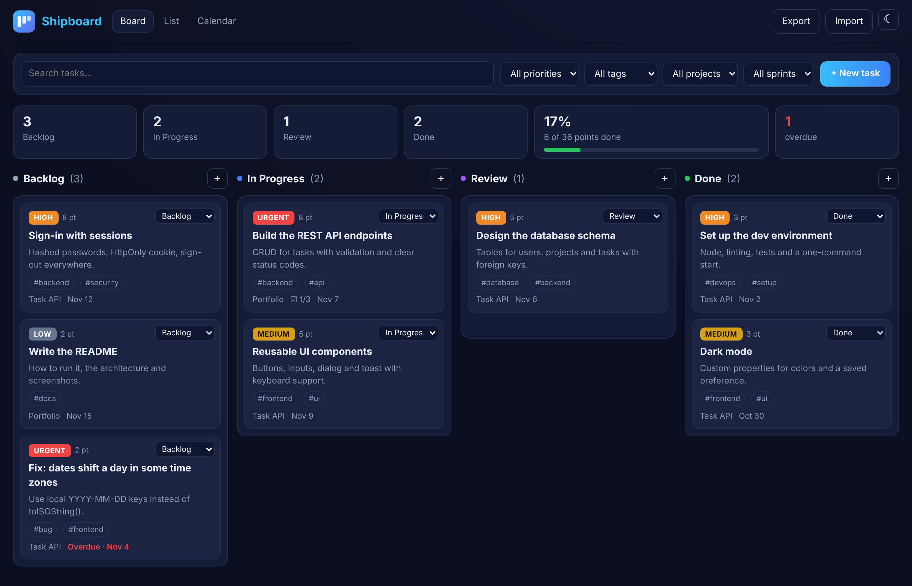
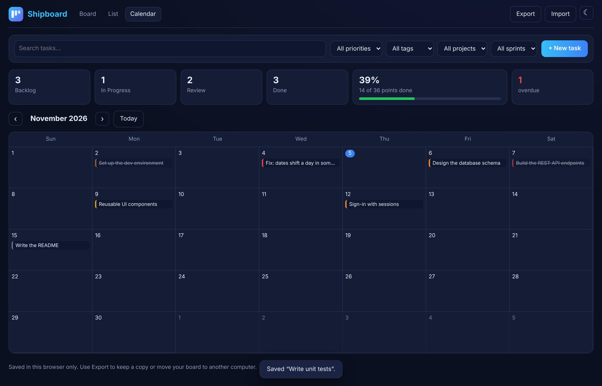
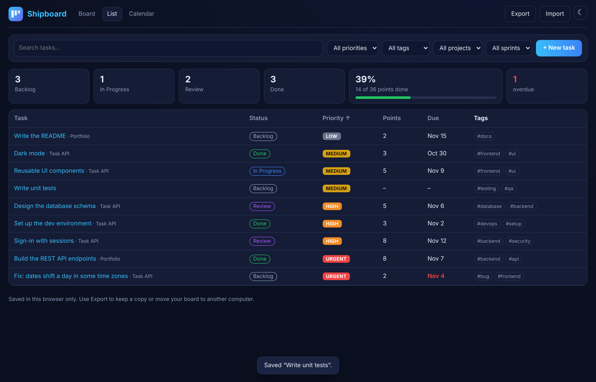
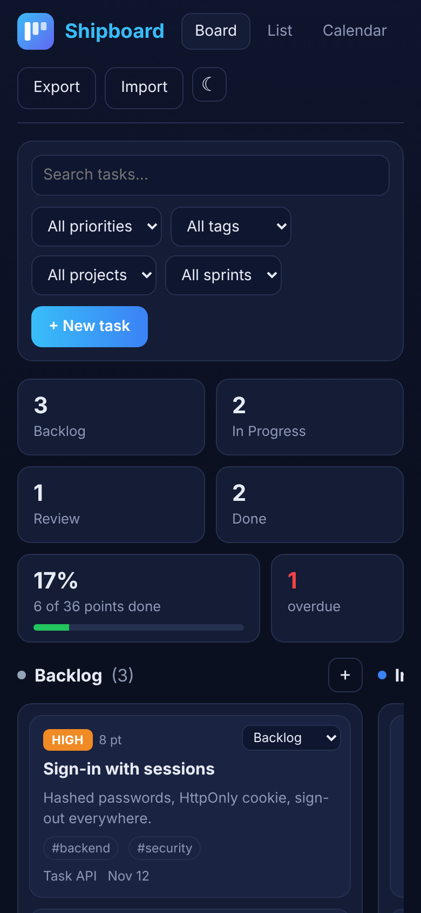

# Shipboard

**▶ [Live demo](https://theoyanvno.github.io/dev-task-board/)**

A task board for developers, built with React. Plan work in **Backlog → In Progress → Review → Done**, drag cards between columns (or use each card's Move menu from the keyboard), and switch to a sortable **list** or a **calendar** of due dates. Tasks have priorities, story points, tags, a project, a sprint, a due date and a checklist. Everything is saved in your browser, and you can export and import the whole board as a file.



| Calendar | List | Phone |
|---|---|---|
|  |  |  |

## Features

- **Board:** four columns with counts; drag a card onto another column or between two cards to place it exactly there. Each card also has a **Move** menu, so nothing needs a mouse.
- **Cards** show the priority (low, medium, high, urgent), story points, tags, project, checklist progress and due date, marked **Overdue** when it's past and not done.
- **Editor:** a real dialog (Escape and focus work as expected) with title, description, status, priority, points, due date, project, sprint, tags and a checklist. A task needs a title, and wrong values are explained, not silently saved.
- **Search and filters** by words, priority, tag, project and sprint, all at once.
- **Progress:** tasks per column, the share of story points done and how many tasks are overdue.
- **List view** sortable by task, status, priority, points or due date; **calendar view** by month.
- **Saved in your browser**, with **Export** and **Import** (a JSON file, checked task by task when it's read back), and light or dark mode. The first visit shows example tasks.

**Tech:** React 19 · JavaScript (ES modules) · CSS grid · HTML drag and drop · `<dialog>` · `localStorage` · esbuild · `node:test`

## How it works

- **All the rules live in [`src/lib/tasks.js`](src/lib/tasks.js), with no React:** cleaning a task, moving it to an exact position (the column is renumbered, so the order is always clear), filtering, sorting, stats and saving. The components only call these functions, and they're tested in Node.
- **Dropping in the right place:** while you drag, the board finds the first card whose middle is below the pointer and shows a marker there; when the card comes from the same column, its old spot is taken into account.
- **Safe loading:** saved or imported boards are read task by task. A broken task is skipped (and counted) instead of losing the whole board, duplicate ids get new ones, and blocked storage is reported instead of failing quietly.
- **Calendar:** [`src/lib/calendar.js`](src/lib/calendar.js) builds the month's weeks from local date keys (YYYY-MM-DD), so due dates never shift a day across time zones.

## Run it

```
npm install
npm start        # builds and serves at http://localhost:8000, rebuilding on every change
npm test         # node --test
npm run build    # writes the site to docs/, which GitHub Pages serves
```

| Path | What's in it |
|---|---|
| `src/App.jsx` | The page: views, filters, stats, export and import |
| `src/components/` | Board and drag and drop, cards, the editor, list and calendar views |
| `src/lib/` | Tasks and every rule about them, and the month grid (no React; tested) |
| `public/` | The HTML page, styles and icon |
| `build.mjs` | Bundles the app with esbuild into `docs/` |

Built with help from AI coding tools for planning, code review and tests.

## License

MIT, see [LICENSE](LICENSE).
